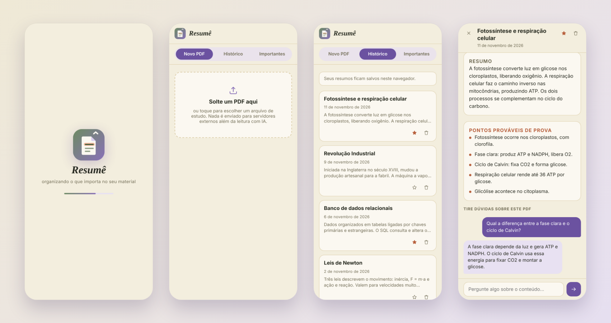
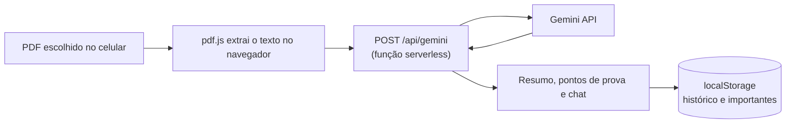

<div align="center">


# Resumê

**Joga um PDF de estudo, recebe o resumo, os pontos que mais caem em prova e um chat para tirar dúvidas.**

Instalável no celular · sem login · seus resumos ficam no seu aparelho



<sub>Capturas feitas com conteúdo de demonstração.</sub>

</div>

---

## O que ele faz

- **Resumo direto**: até 3 frases com a ideia central do material.
- **Pontos prováveis de prova**: de 5 a 7 itens curtos (definições, datas, fórmulas, conceitos que se repetem).
- **Chat com o PDF**: pergunte sobre o conteúdo e receba respostas curtas, baseadas só naquele documento.
- **Histórico**: cada PDF vira um card com tema e data. Ao abrir, você vê o resumo, os destaques e as perguntas que fez.
- **Importantes**: marque com a estrela os resumos que quer revisar de novo. A lixeira pede confirmação antes de apagar.
- **Funciona como app**: instala na tela inicial do celular e abre o histórico mesmo sem internet.

## Como funciona



1. O PDF é lido **no navegador** com [PDF.js](https://mozilla.github.io/pdf.js/). O arquivo em si não é enviado para lugar nenhum.
2. O texto extraído vai para a rota `/api/gemini`, uma função serverless de ~50 linhas que guarda a chave da API **no servidor**. O navegador nunca vê a chave.
3. A função chama o Gemini e devolve só o texto da resposta.
4. Resumos, destaques, perguntas e estrelas ficam no `localStorage`. Não há banco de dados nem conta de usuário.

Os prompts pedem JSON com `titulo`, `resumo` e `destaques` e limitam o tamanho de cada parte. O app lê a resposta mesmo quando ela vem dentro de um bloco ```` ```json ````.

## Instalar no celular

O app precisa estar publicado em **HTTPS** (veja a seção de deploy abaixo). Depois:

| Aparelho | Passos |
|---|---|
| **Android (Chrome)** | Abra o link → menu ⋮ → **Instalar app** (ou **Adicionar à tela inicial**) |
| **iPhone (Safari)** | Abra o link → botão **Compartilhar** → **Adicionar à Tela de Início** |
| **Computador (Chrome/Edge)** | Clique no ícone de instalar na barra de endereço |

No iPhone precisa ser o Safari. Em outros navegadores a opção não aparece.

## Publicar a sua versão (grátis)

Você vai precisar de uma conta no GitHub, uma no [Vercel](https://vercel.com) e uma chave do Gemini.

1. **Chave do Gemini:** crie em <https://aistudio.google.com/apikey>.
2. **Repositório:** suba esta pasta para o seu GitHub.
3. **Vercel:** *Add New → Project* → importe o repositório.
4. **Variável de ambiente:** em *Environment Variables* adicione `GEMINI_API_KEY` com a sua chave.
5. **Deploy.** O Vercel entrega uma URL `https://...vercel.app`. Abra no celular e instale.

Variável opcional: `GEMINI_MODEL` troca o modelo (padrão `gemini-3.8-flash`). Se o Google aposentar esse nome, é só colocar o novo aqui, sem mexer no código.

> O GitHub Pages sozinho não serve para este projeto, porque ele não executa a função que guarda a chave. Use o Vercel (ou outro serviço com funções serverless).

## Rodar localmente

```bash
npm i -g vercel
echo "GEMINI_API_KEY=sua-chave" > .env
vercel dev
```

Só para ver a interface, sem IA: `python3 -m http.server 8000` e abra <http://localhost:8000>. O resumo e o chat não funcionam nesse modo.

## Estrutura

```
index.html          # app inteiro: interface, lógica, estilos
standalone.js       # liga o app à rota /api/gemini e registra o service worker
api/gemini.js       # função serverless que chama o Gemini (guarda a chave)
sw.js               # service worker: instalação e uso offline do histórico
manifest.webmanifest
icons/              # logo em SVG e PNG (incluindo ícone maskable)
docs/               # imagens deste README
```

Sem framework e sem build: HTML, CSS e JavaScript puros.

## Privacidade e limites

- O **texto** do PDF é enviado ao Gemini para gerar as respostas. Evite material confidencial e confira os termos do plano gratuito da API do Google.
- Seu histórico fica só no navegador. Limpar os dados do site apaga tudo.
- A função aceita até 60 mil caracteres por pedido, e o app lê até 50 páginas por PDF.
- PDFs escaneados (só imagem) não têm texto para extrair e não funcionam.
- A cota gratuita do Gemini é limitada. Se estourar, o app avisa e você tenta de novo depois.

## Próximos passos

- [ ] Quiz automático a partir do resumo
- [ ] Vários PDFs da mesma matéria num guia único
- [ ] OCR para PDFs escaneados
- [ ] Limite de pedidos por visitante na função
- [ ] Exportar resumo e destaques

## Créditos

[PDF.js](https://mozilla.github.io/pdf.js/) (Mozilla) · Fontes [Fraunces](https://fonts.google.com/specimen/Fraunces), [Space Grotesk](https://fonts.google.com/specimen/Space+Grotesk) e [Inter](https://fonts.google.com/specimen/Inter) · IA: Gemini API

Feito por **SEU NOME** · [GitHub](https://github.com/SEU-USUARIO)
